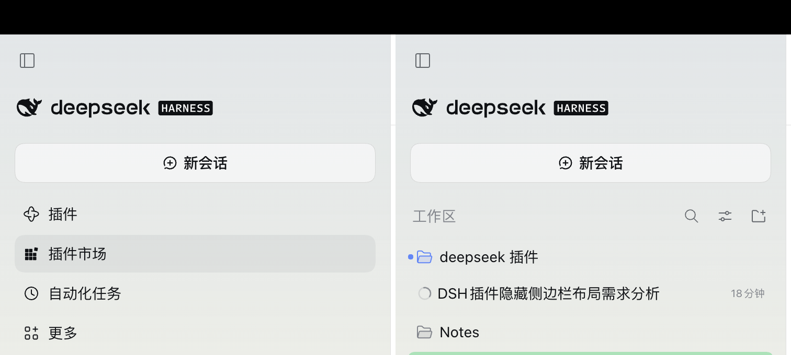

# Sidebar Trim · dsh-sidebar-trim

Hides the sidebar's global panel navigation — **Plugins / Market / Schedules / More** — and gives the vertical space back to your session list.

- Expanded sidebar: saves **≈158px** (4 × 36px rows plus gaps and the list's bottom margin)
- Collapsed rail / phone drawer: saves **≈192px** (wider gaps)

## Why it exists

1. On a phone the sidebar drawer is short; those four rows cost exactly the height of two or three sessions.
2. The Slot API can only add entries, never hide them: once a plugin registers in `sidebar.panellist` it owns a row, and the Plugins row is hard-wired to always show (`id === "plugins" || !unpinned.includes(id)`), so the sidebar's own pin/unpin cannot hide it either.
3. This plugin does exactly one thing: anchor on the slot contract — the only `nav` inside `[data-slot="sidebar"]` — and set it to `display: none`. No hashed class names, no DOM surgery, no fighting other plugins for registrations.

## Install

Search `dsh-sidebar-trim` in the DSH plugin market, or install this directory as a local package into the current profile.

## Three modes

Pick one in **Settings → Sidebar**; the sidebar changes as you pick — no reload, no reinstall.

| Mode | Effect |
|---|---|
| Hide all (default) | Plugins / Market / Schedules / More all collapse |
| Keep “More” | Hide the three rows, keep one More button to reach the collapsed panels |
| Hide nothing | Restore the factory sidebar, for a side-by-side look |

The choice is remembered in this browser (`localStorage`); another browser, or cleared site data, starts from the default.

## Undo

**Settings → Sidebar → Hide nothing** restores the rows on the spot. To remove the plugin entirely, **Settings → Plugins → turn off “Sidebar Trim”** — also without a page reload.

> With the navigation hidden, **Market** and **Schedules** lose their sidebar entry too; reach them from **Settings → Plugins** when needed.

## Compatibility

- Targets DSH 0.2.x (Web and desktop share the same renderer)
- Depends on the `[data-slot="sidebar"]` slot anchor and the `nav` semantics of the sidebar
- If a future release changes the sidebar structure, the plugin **fails silently** (the UI returns to normal; nothing breaks or blocks startup) and gets a patch release for the selector

## License

MIT
