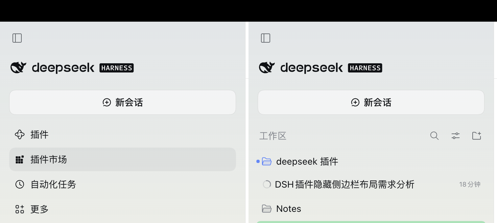

# 侧栏精简 · dsh-sidebar-trim

隐藏侧栏顶部的全局面板导航——**插件 / 插件市场 / 自动化任务 / 更多**——把省下来的垂直空间还给会话列表。

- 展开态省 **≈158px**（4 × 36px 行高 + 行距 + 列表下边距）
- 窄栏 / 手机抽屉态省 **≈192px**（行距更大）

## 为什么需要它

1. 手机上侧栏抽屉本身就不高，这四行吃掉的正好是两三条会话的高度。
2. 槽位 API 只能"加"不能"减"：`sidebar.panellist` 注册了就有一行，没有隐藏入口；而且「插件」这一行在 shell 里是硬编码常驻的（`id === "plugins" || !unpinned.includes(id)`），连侧栏自带的 pin/unpin 都藏不掉它。
3. 所以本插件只做一件事：锚定槽位契约 `[data-slot="sidebar"]` 里唯一的 `nav`，把它设为 `display:none`。不碰构建哈希类名、不改 DOM 结构、不抢别人的槽位注册。

## 安装

在 DSH 插件市场搜索 `dsh-sidebar-trim` 安装，或把本目录作为本地包安装到当前 profile。

## 三档模式

**设置 → 侧栏** 里随时换，选中那一刻侧栏就变，不用刷新、不用重装：

| 模式 | 效果 |
|---|---|
| 全部隐藏（默认） | 插件 / 插件市场 / 自动化任务 / 更多 一起收起 |
| 保留「更多」 | 只收三行面板入口，留一个「更多」按钮随时打开被收起的面板 |
| 不隐藏 | 恢复出厂侧栏，用来临时对照 |

选择记在本机浏览器（`localStorage`），换浏览器或清空站点数据后回到默认。

## 恢复

**设置 → 侧栏 → 不隐藏** 即可当场复原；彻底移除则去 **设置 → 插件 → 关闭「侧栏精简」**，同样不需要刷新页面。

> 导航隐藏后，「插件市场 / 自动化任务」也会失去侧栏入口；需要时经 **设置 → 插件** 进入。

## 兼容性

- 目标：DSH 0.2.x（Web 与桌面同一渲染层）
- 依赖：槽位锚点 `[data-slot="sidebar"]` 与侧栏导航的 `nav` 语义
- 若未来版本改了侧栏结构：插件会**静默失效**（界面恢复原样，不报错、不影响启动），届时发补丁版本修选择器即可

## 许可

MIT
